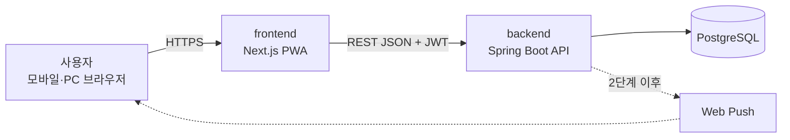

# pet-room

[](https://github.com/hamon1/pet-room/actions/workflows/ci.yml)

반려동물의 건강·의료·먹이를 한곳에서 관리하고, 놓치기 쉬운 일정(의료·투약·유통기한·재구매)을 달력과 알림으로 챙겨 주는 펫케어 웹앱입니다.
도트 그래픽의 방 안에서 내 반려동물이 돌아다니는 **방치형 육성 게임** 감성을 목표로 합니다.

> 현재 단계: **3단계 - 먹이·달력** (먹이 재고, 주요 이벤트·달력, 알림 시점·테마 설정, 메인 방 화면)
> 전체 계획은 [docs/roadmap.md](docs/roadmap.md)를 참고하세요.

## 핵심 기능 (MVP)

| 영역 | 기능 |
| --- | --- |
| 반려동물 | 분류(포유류·조류·어류) → 세부 분류(강아지·고양이 / 핀치류·앵무류 / 어류는 개체·어항 단위) 등록 |
| 기록 | 건강 상태(식사·배변·체중·메모), 의료 정보(진료·접종·투약·치료), 분류별 특수 항목 |
| 먹이 | 사료·간식 재고, 유통기한, 급여량 기반 소진 예상일, 여러 마리 공유 재고 |
| 달력·알림 | 주요 이벤트 4종(의료 일정·치료 정보·유통기한 임박·재구매 필요) 강조와 알림 |
| 화면 | 도트 방 메인 화면, 빠른 기록·일괄 기록, 색상 테마(파스텔 / 블랙 앤 화이트) |

## 아키텍처



자세한 내용: [docs/architecture.md](docs/architecture.md) · [docs/erd.md](docs/erd.md) · [docs/api.md](docs/api.md) · [docs/decisions.md](docs/decisions.md) · [docs/setup-oauth.md](docs/setup-oauth.md)

## 기술 스택

| 구분 | 기술 | 선택 이유 |
| --- | --- | --- |
| 백엔드 | Java 21, Spring Boot 3, Spring Security, Spring Data JPA | 국내 백엔드 채용에서 널리 쓰이는 스택, 인증·검증·트랜잭션을 표준 방식으로 구현 |
| DB | PostgreSQL, Flyway | 관계형 데이터(동물-기록-먹이)에 적합, 스키마 변경 이력을 코드로 관리 |
| 인증 | JWT (Spring Security OAuth2 Resource Server) | 서버에 세션을 두지 않는 구조로 웹·앱(추후 Capacitor) 모두 같은 방식 사용 |
| 프론트엔드 | Next.js, TypeScript | 하나의 코드로 웹·PWA 배포, 이후 Capacitor로 앱스토어 확장 가능 |
| 테스트 | JUnit 5, MockMvc, Testcontainers | 실제 PostgreSQL로 통합 테스트 |
| CI | GitHub Actions | 푸시마다 백엔드 테스트, 프론트엔드 빌드 |

선택 배경과 대안 비교는 [docs/decisions.md](docs/decisions.md)에 기록합니다.

## 로컬 실행

필요한 도구: Java 21, Node.js 20 이상, Docker

```bash
# 1. DB 실행
docker compose up -d

# 2. 백엔드 (http://localhost:8080)
cd backend
./gradlew bootRun

# 소셜 로그인을 쓰려면 docs/setup-oauth.md의 환경변수를 먼저 지정

# 3. 프론트엔드 (http://localhost:3000)
cd frontend
cp .env.example .env.local
npm install
npm run dev
```

백엔드 테스트는 Docker가 켜져 있어야 실행됩니다 (Testcontainers 사용).

```bash
cd backend && ./gradlew test
```

## 폴더 구조

```
pet-room/
├── backend/            Spring Boot API 서버
├── frontend/           Next.js PWA
├── docs/               설계 문서 (아키텍처, ERD, API, 의사결정, 로드맵)
├── docker-compose.yml  로컬 PostgreSQL
└── .github/workflows/  CI
```

## 기록

- 트러블슈팅과 운영 기록: [docs/troubleshooting](docs/troubleshooting/)
