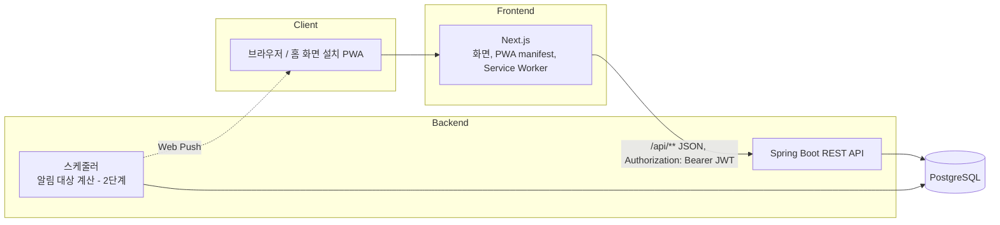
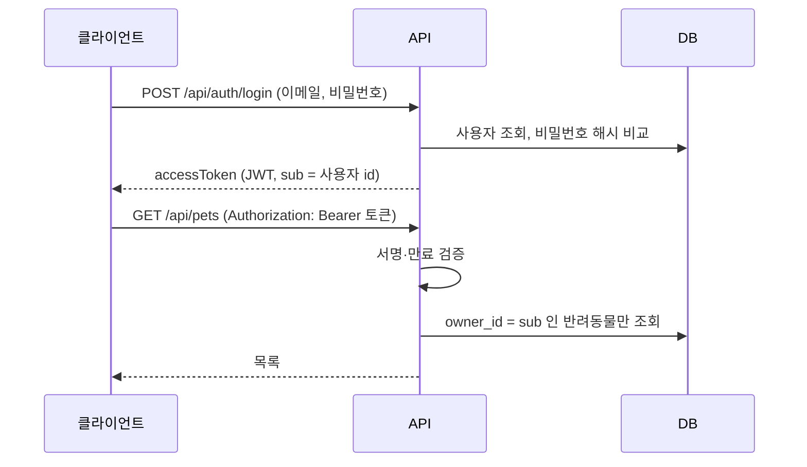

# 아키텍처

## 구성



- **프론트엔드와 백엔드는 분리**합니다. 프론트엔드는 화면만 담당하고 모든 데이터는 API로 주고받습니다. 이후 Capacitor로 앱을 만들 때도 같은 API를 씁니다.
- **기록은 서버 DB에 저장**합니다. iOS PWA는 오래 열지 않으면 기기 저장소가 비워질 수 있어, 기기에는 데이터를 두지 않습니다.
- **주요 이벤트(의료 일정·치료 정보·유통기한 임박·재구매 필요)는 저장하지 않고 계산**합니다. 원본 데이터(의료 기록의 다음 예정일, 먹이의 유통기한·남은 양·급여량)에서 매번 도출해 데이터 중복과 불일치를 막습니다.

## 백엔드 패키지 구조

기능(도메인) 단위로 나눕니다.

```
com.petroom
├── auth      회원가입, 로그인, 토큰 발급
├── user      사용자 정보
├── pet       반려동물 등록·조회·수정·삭제
├── record    건강·특수 항목 기록 (2단계)
├── medical   의료 기록 (2단계)
├── food      먹이 재고 (3단계)
├── event     주요 이벤트 계산, 달력 (3단계)
└── global    보안 설정, 공통 오류 응답
```

각 도메인은 `Controller → Service → Repository` 순서로 호출합니다. Controller는 요청 검증과 응답 변환만, 업무 규칙은 Service에 둡니다.

## 인증 흐름



- 다른 사람의 반려동물 id로 요청하면 **404**를 돌려줍니다. 403을 주면 해당 id가 존재한다는 사실이 드러나기 때문입니다.
- 소셜 로그인(카카오·구글)은 2단계에서 같은 토큰 발급 흐름에 붙입니다.

## 배포 계획

| 단계 | 대상 | 비고 |
| --- | --- | --- |
| 1 | 로컬 + CI | 이번 단계 |
| 2 | 웹 배포 (PWA) | 프론트엔드 웹 호스팅, 백엔드·DB 클라우드 서버. 서비스는 가입 전 공식 가격 페이지에서 비용 확인 후 결정 |
| 3 | 앱스토어 (선택) | 같은 프론트엔드를 Capacitor로 포장 |
