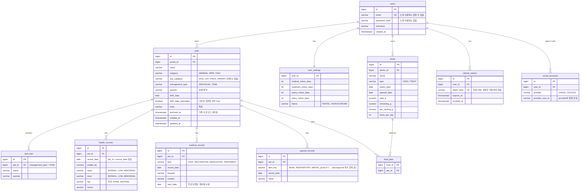

# ERD

MVP 전체 테이블 설계입니다. 단계별로 Flyway 마이그레이션을 추가합니다.

| 마이그레이션 | 단계 | 테이블 |
| --- | --- | --- |
| V1 | 1 | `users`, `pets` |
| V2 | 2 | `health_records`, `medical_records`, `special_records`, `tank_fish` |
| V3 | 2 | `refresh_tokens`, `social_accounts` (소셜 사용자를 위해 `users.email`, `password_hash` nullable) |
| 예정 | 3 | `foods`, `food_pets`, `user_settings` |

## 설계 메모

- **분류와 세부 분류의 조합 규칙**은 DB 제약 대신 서비스 계층에서 검사합니다. 분류가 늘어날 때 마이그레이션 없이 규칙만 바꾸기 위해서입니다.
  - 포유류: 세부 분류 DOG 또는 CAT, 관리 방식 INDIVIDUAL
  - 조류: 세부 분류 FINCH 또는 PARROT, 관리 방식 INDIVIDUAL
  - 어류: 세부 분류 없음, 관리 방식 INDIVIDUAL 또는 TANK
- **먹이 재고는 사용자 단위**로 두고 `food_pets`로 먹는 동물을 연결합니다. 여러 마리가 같은 사료를 먹을 때 재고가 하나로 관리됩니다.
- **소진 예상일** = 남은 양 ÷ (1회 급여량 × 하루 급여 횟수 × 먹는 동물 수). 저장하지 않고 계산합니다.
- **나이로 입력**하면 출생일을 역산해 저장하고 `birth_date_estimated = true`로 표시합니다.
- 가족 공유(확장 단계)가 들어오면 `owner_id` 대신 가구(household) 단위로 소유를 옮깁니다.
