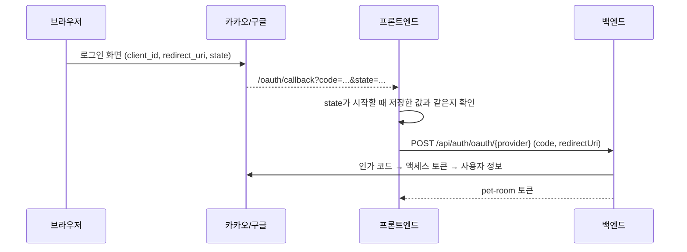

# 소셜 로그인 설정

카카오·구글 로그인은 각 개발자 콘솔에서 앱을 만들고 키를 넣어야 켜집니다. 키가 없으면 로그인 화면의 버튼이 비활성화되고, 서버는 `OAUTH_PROVIDER_DISABLED`로 응답합니다.

콘솔 화면과 메뉴 이름은 바뀔 수 있으니 각 공식 문서를 기준으로 진행하세요.

## 1. 콜백 주소

프론트엔드 주소 + `/oauth/callback`

- 로컬: `http://localhost:3000/oauth/callback`
- 배포 후: `https://<배포 도메인>/oauth/callback`

이 주소를 **양쪽 콘솔**과 **백엔드 환경변수**에 똑같이 등록합니다.

## 2. 카카오

공식 문서: <https://developers.kakao.com/docs/latest/ko/kakaologin/rest-api>

1. 카카오 개발자 콘솔에서 애플리케이션 추가
2. 카카오 로그인 활성화, Redirect URI에 콜백 주소 등록
3. 동의 항목: 닉네임(필수 권장), 이메일(선택)
4. 보안 메뉴에서 Client Secret을 사용한다면 값을 복사

## 3. 구글

공식 문서: <https://developers.google.com/identity/openid-connect/openid-connect>

1. Google Cloud 콘솔에서 OAuth 동의 화면 구성
2. OAuth 클라이언트 ID 만들기 (웹 애플리케이션), 승인된 리디렉션 URI에 콜백 주소 등록
3. 클라이언트 ID와 클라이언트 보안 비밀번호 복사

## 4. 환경변수

백엔드 (`backend` 실행 환경):

```bash
KAKAO_CLIENT_ID=카카오_REST_API_키
KAKAO_CLIENT_SECRET=카카오_클라이언트_시크릿   # 사용하지 않으면 비워 둠
GOOGLE_CLIENT_ID=구글_클라이언트_ID
GOOGLE_CLIENT_SECRET=구글_클라이언트_보안_비밀번호
OAUTH_ALLOWED_REDIRECT_URIS=http://localhost:3000/oauth/callback
```

프론트엔드 (`frontend/.env.local`):

```bash
NEXT_PUBLIC_KAKAO_CLIENT_ID=카카오_REST_API_키
NEXT_PUBLIC_GOOGLE_CLIENT_ID=구글_클라이언트_ID
```

클라이언트 ID는 브라우저에 노출되어도 되는 값이고, **시크릿은 백엔드에만** 둡니다.

## 동작 순서


